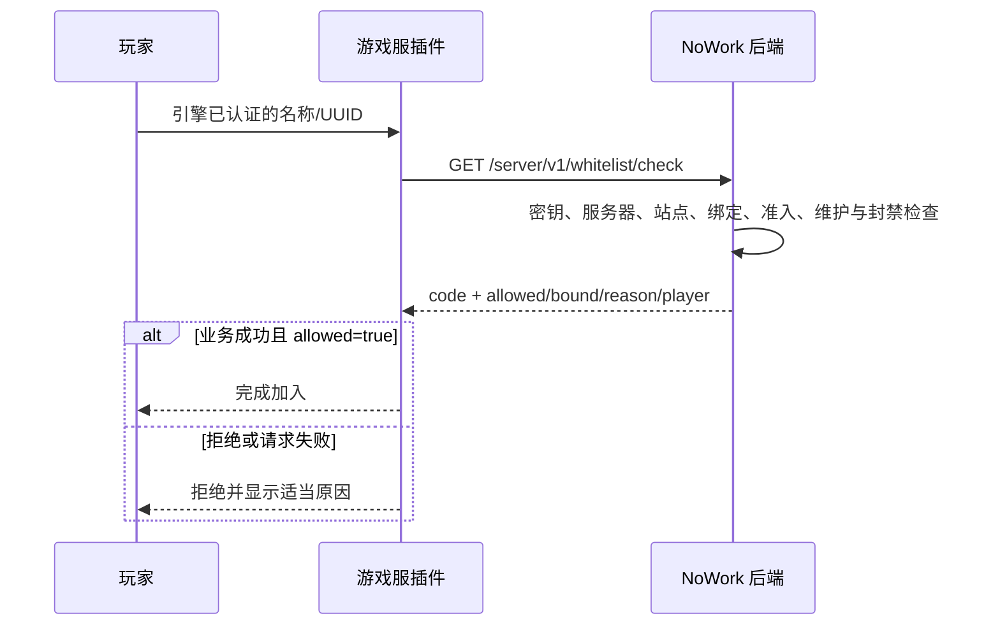

# 游戏服务器完整对接指南

适用对象：游戏服、代理服、游戏插件、启动器开发者。本文按“创建服务器 → 绑定角色 → 玩家进服 → 在线运行 → 运维验收”组织；字段全集见 [协议](PROTOCOL.md) 和 [完整接口参考](API_REFERENCE.md)。如果目标是第三方网站登录，先读 [OIDC 指南](OIDC_INTEGRATION.md)。

## 1. 先选对接口和凭据

| 组件 | 调用入口 | 凭据 | 用途 |
| --- | --- | --- | --- |
| 游戏服务器／代理插件 | `/server/v1/*` | `X-Server-Key` | 白名单、心跳、GM、玩家数据与封禁 |
| 网站／启动器登录 | `/oauth2/*` | OAuth 客户端＋授权码／令牌 | 登录到自己的应用 |
| 玩家在用户中心绑定角色 | `/api/account/*` | 用户中心会话 | 玩家本人操作 |
| 独立 GM 网站兑换角色身份 | `/server/v1/gm/sso/exchange` | 服务器密钥＋一次性 code＋PKCE | 仅证明选定角色身份 |
| 接收事件的插件服务 | 自己提供的 HTTPS URL | Webhook 签名密钥 | 账号／角色变化推送 |

服务器密钥只放在服务端配置或密钥存储中。客户端、网页、公开插件配置样例不放密钥。OAuth 客户端密钥、Webhook 签名密钥、JWE 私钥和服务器密钥各有用途，不能互换。

## 2. 准备部署和接入资料

记录以下实际值：

| 配置 | 示例 | 核对方式 |
| --- | --- | --- |
| 后端／issuer 基地址 | `https://account.example.com` | 已安装实例的 `/healthz`、OIDC discovery |
| 前端基地址 | `https://account.example.com` | 玩家能在浏览器正常登录；分离部署时可能不同 |
| 服务器代码 | `survival` | 后台服务器配置；用于登录页、加密上下文 |
| 服务器数字 ID | 后台返回的 ID | 管理端／服主 API 使用，不是代码 |
| 服务器密钥 | 后台生成的一次性明文 | 属于这台服务器；后端保存哈希 |
| 名称／UUID 来源 | 游戏引擎认证后的身份 | 不采用客户端任意声明的 UID／UUID |
| 可选 OAuth 客户端 | 后台接入应用 | 启动器或 SDK 登录页才需要 |

基地址不加 `/api` 或 `/server/v1` 后缀，SDK 会添加各接口路径。正式环境使用 HTTPS；反向代理需转发 `/server/`、`/oauth2/`、`/.well-known/`、`/jwks.json` 和相关 `/api/` 路径，不能把 API 请求兜底成 HTML 首页。

### 创建与审批

1. 管理员在游戏服务器管理中创建服务器；或服主在用户中心“我的服务器”申请。
2. 核对服务器所属站点、服主、游戏类型、角色名称／UUID 规则、绑定上限及准入条件。
3. 自助申请需要审核通过；生成服务器密钥后立即存入插件的私有配置。
4. 按实际需要启用 `server-gm`、`server-users`、`sdk-login` 等模块。模块清单可通过 `GET /server/v1/modules` 读取，未启用的模块不出现在结果中。
5. 玩家完成用户中心账号要求、首次资料／TAG 设置和服务器申请，再绑定角色。管理审核、信任条件和封禁策略都仍生效。

密钥存在不表示服务器已获准使用接口。HTTP 401 通常表示密钥错误或已轮换；HTTP 403 表示密钥有效但服务器未获准等情况。站点、功能或账号限制也可能以 HTTP 200 的非零业务码返回，必须同时检查 HTTP 和信封。

## 3. 跑通第一次请求

下面是 PowerShell 示例。预先在当前进程设置 `NOWORK_BASE` 和 `NOWORK_SERVER_KEY`；命令不会生成或替代后台密钥。

```powershell
if (-not $env:NOWORK_BASE -or -not $env:NOWORK_SERVER_KEY) {
    throw '请先设置 NOWORK_BASE 和 NOWORK_SERVER_KEY'
}
$base = $env:NOWORK_BASE.TrimEnd('/')
$headers = @{ 'X-Server-Key' = $env:NOWORK_SERVER_KEY; 'X-Lang' = 'zh_CN' }
$result = Invoke-RestMethod -Uri "$base/server/v1/whitelist" -Headers $headers
if ($result.code -ne 0) { throw $result.message }
$result.data
```

成功结果外层为 `{"code":0,"message":"...","data":...}`。`data` 默认包含 `server`、`mode`、`count`、`entries`。启用加密后需要使用已配置解密钥的 SDK，不能直接把 `data.jwe` 当成白名单数组。

Go 最小进服校验程序如下。创建 Go 工程后，按[本地接入的 Go require / replace 步骤](LOCAL_SETUP.md#go本地-require--replace)引用这份源码；语言能力见 [Go README](../go/README.md)。不要假定本次本地 1.3.0 已经发布到远程。

```go
package main

import (
    "context"
    "log"
    "net/http"
    "os"
    "time"

    nowork "github.com/wangework/nowork-sdk-go"
)

func main() {
    base, key := os.Getenv("NOWORK_BASE"), os.Getenv("NOWORK_SERVER_KEY")
    if base == "" || key == "" { log.Fatal("NOWORK_BASE and NOWORK_SERVER_KEY are required") }
    client := nowork.New(base, nowork.WithServerKey(key),
        nowork.WithHTTPClient(&http.Client{Timeout: 5 * time.Second}))
    ctx, cancel := context.WithTimeout(context.Background(), 5*time.Second)
    defer cancel()
    result, err := client.CheckWhitelist(ctx, "Steve", "069a79f4-44e9-4726-a5be-fca90e38aaf5")
    if err != nil { log.Printf("join check failed: %v", err); return }
    if !result.Allowed { log.Printf("join denied: %s %s", result.Reason, result.Message); return }
    if result.Player != nil { log.Printf("join allowed for uid=%d", result.Player.UID) }
}
```

将示例玩家替换为游戏引擎已确认的实际身份。HTTP 校验放到游戏引擎的异步事件／任务中，只有允许结果到达后才完成加入；断开、超时或服务器关闭后不再回写过期的加入事件。

可直接运行的完整循环在 [game-server-go](../examples/game-server-go/README.md)，Paper 与 Velocity 适配入口在 [示例目录](../examples/README.md) 和 [Java 示例](../java/examples/velocity/README.md)。示例的 `OUTAGE_POLICY` 可选 `cache/deny/allow`；正式接入先选 `deny`，其他策略需要明确接受离线期间撤销／封禁不能实时同步的后果。

## 4. 玩家进入服务器的判定



`name` 与 `uuid` 至少给一个。当前实现的绑定查找在两者都提供时使用“UUID 或不区分大小写的名称匹配”，不是两者一致性证明；因此必须使用游戏引擎确认的名称和 UUID。UUID 格式会规范化。服务器封禁等额外检查仍会执行。

| 字段 | 处理规则 |
| --- | --- |
| `allowed` | 唯一的最终加入判定；不能只看 `bound`、`mode` 或 HTTP 200 |
| `bound` | 表示结果是否携带有效绑定信息，不等同于允许加入 |
| `player` | 可为空；有值时使用其中的 `uid` 关联本地玩家数据 |
| `reason` | 稳定机器码，适合程序分支；保留未知码的拒绝处理 |
| `message` | 可本地化的人类说明，可为空，不适合据此判断权限 |

白名单模式：0 关闭白名单、1 人工审核、2 按条件自动通过。**模式 0 只允许部分未绑定玩家走快捷路径，仍受服务器准入、维护、冻结、封禁等限制；已绑定结果也可能 `bound=true`。** 全量名单用于同步与有限缓存，实时 `/whitelist/check` 才执行完整进服判定。

常见拒绝包括 `not bound`、`pending review`、`banned`、`account locked`、`account missing`、`server access required`、`maintenance`、`check unavailable`。不要把未知理由、检查不可用或解密失败解释为允许。

## 5. 心跳、在线名单与服务器状态

每 60 秒左右上报一次，并加入少量随机抖动，避免大量服务器同时请求。默认 5 分钟无心跳会被视为离线。游戏主线程只采集快照，网络请求在工作线程进行。

```json
{
  "online": 2,
  "max": 50,
  "version": "1.21.1",
  "tps": 19.8,
  "players": [
    {"name":"Steve","uuid":"069a79f4-44e9-4726-a5be-fca90e38aaf5"},
    {"name":"Alex"}
  ]
}
```

发送到 `POST /server/v1/heartbeat`。`online` 是当前人数，不是累计登录数；`max` 是容量。`players` 对应当前在线名单，影响玩家匹配、聊天和踢出列表，不能只报人数后又依赖精确踢人结果。六种 SDK 均支持 TPS 与玩家列表；无效／非有限 TPS 和空列表的发送规则见协议。

服务器运行状态与白名单模式是两个字段：`serverStatus` 的 0 为在线、1 为离线、2 为维护。维护不是撤销密钥；即使心跳正常，普通玩家仍可能被维护门禁拒绝。后端按分钟保留采样、默认保留 30 天，客户端无需在心跳中自行提交服务器时间戳。

## 6. GM 指令通道

1. `GET /server/v1/modules` 确认 `server-gm` 可用。
2. 启动与能力变化时 `PUT /server/v1/gm/actions` 发布动作清单；用 `PUT /server/v1/gm/options` 更新具名选项。
3. 按受控间隔 `GET /server/v1/gm/commands` 拉取已授权且通过参数校验的命令。
4. 在游戏服执行后 `POST /server/v1/gm/commands/{id}/result`，提交实际结果。

```json
{
  "actions": [{
    "key":"broadcast", "title":"全服公告", "category":"chat", "danger":"confirm",
    "params":[{"name":"message","type":"string","required":true,"maxLength":200}]
  }],
  "options": {}
}
```

动作与选项支持部分发布：省略或传 null 的 actions 表示保留既有动作，空数组表示清空；具体 SDK 方法见 [PROTOCOL §2.4](PROTOCOL.md#24-功能模块与-gm-面板2026-09-22)。不合规条目通过 `skipped` 返回，必须检查发布结果，不能只检查 HTTP 成功。

拉取会把命令标记为 `sent`；这不是可任意重复拉取的消息队列，也不是执行恰好一次保证。以命令 `id` 做本地持久去重，把“尚未执行／已执行待回执／已回执”分开。执行完成而回执失败时只重试回执，不再重放游戏操作；命令积压或状态不明应交由管理者核对。尚未拉取命令默认 5 分钟过期，每台服务器未完成命令上限 50。

```json
{"ok":true,"result":"announcement delivered to 2 players"}
```

不要把参数拼成任意 shell 命令。将已发布动作映射到明确的游戏 API，再做本地类型和目标检查。管理员、服主和授权工作人员来源的含义见协议；独立 GM 角色登录见 [GM_SSO](GM_SSO.md)，登录成功不会自动授予执行任意管理命令的权限。

## 7. 玩家数据与服务器封禁

| 路径 | 目的 | 写入要点 |
| --- | --- | --- |
| `/server/v1/users/schema` | 获取字段、类型、容量 | 读取后再构造数据 |
| `/server/v1/users/{uid}/data` | GET／PUT／PATCH 玩家数据 | `uid` 来自后端已验证绑定；带 `version` 做乐观锁 |
| `/server/v1/bans` | 查询／增加服务器封禁 | 写入要求模块及 `pluginBans` 允许 |
| `/server/v1/bans/kick` | 取得当前应断开的玩家 | 心跳后读取，执行踢出 |
| `/server/v1/bans/lift` | 解除服务器封禁 | 不等于解冻全站账号 |

```json
{"data":{"coins":20,"rank":"gold"},"version":3}
```

PUT 整体替换；PATCH 合并，字段 null 表示删除；409 表示版本冲突，重新读取并合并后再提交。不要在冲突时去掉版本号覆盖其他服务的更新。字段、类型、容量、名单限制和封禁匹配详见 [SERVER_USERS](SERVER_USERS.md)。读取封禁与踢出名单不要求 `server-users` 开启，关闭该模块不会解除已有封禁。

## 8. 游戏客户端登录和三种登录流程

| 流程 | 浏览器入口 | 服务端换取结果 |
| --- | --- | --- |
| 普通 OIDC | `/oauth2/authorize` | OIDC 令牌和用户身份 |
| 品牌 SDK 登录页 | `FRONTEND/sdk/login/{serverCode}` | 同一套 OAuth 授权码，使用 `/oauth2/token` 兑换 |
| 独立角色 GM SSO | `/home/gm/authorize`，先取得启动请求 | `/server/v1/gm/sso/exchange` 返回角色身份 |

SDK 登录页必须启用模块、选择接入应用并登记回调；使用 S256 PKCE。公有客户端不携带 client_secret。state、nonce、verifier 每次新生成并绑定当前登录尝试；回调先核对 state 和 issuer，再换码、验证 ID Token。`ui_locales` 支持简中、繁中、英语、日语；自定义模板语言更新和沙箱桥接见 [LOGIN_TEMPLATES](LOGIN_TEMPLATES.md)。

回调、登录码、postMessage 三类交付方式必须按当前服务端配置实现，不能只截取 URL 中任意一个 code。postMessage 需验证来源 origin、窗口 source 与关联 state。完整令牌与本地会话处理见 [OIDC 指南](OIDC_INTEGRATION.md)。

## 9. Webhook、投递配置与加密

Webhook 可用于账号冻结／删除后踢人、角色审核后同步缓存，但不能代替每次进服授权。处理顺序为：限制请求体大小 → 保留原始字节 → 验证时间窗和 HMAC → 如有 JWE 则解密并核对内外事件一致性 → 按事件 ID 幂等处理 → 成功后返回 2xx。业务重试只依赖稳定 ID，不依赖消息文字或到达顺序。

签名输入是 `timestamp + "." + 原始 body`，不能先解析再 JSON 序列化。SDK 的容差参数关闭行为在各语言接口中有明确约定；正式服务保持有效时间窗，并同步操作系统时钟。

配置 Server API 加密时，准备 SDK 支持的私钥、准确 `serverCode` 和密钥轮换重叠期。校验 `ctx=server:<code>:<route>`；启用解密后的白名单接口遇到明文、错误路由／服务器、错误密钥一律拒绝，不能按网络故障降级。属性重命名、pairwise subject、签名／加密 UserInfo、算法支持差异见 [DELIVERY](DELIVERY.md)。自定义投递可能改变默认字段形状，此时用 raw 接口和明确的业务模型处理。

## 10. 聊天、权益和游戏资料扩展

- 游戏聊天中继：`/server/v1/chat/relay` 拉取，实际发送到游戏后再 `/chat/relay/ack`；游戏消息通过 `/chat/messages` 上报。票据、WebSocket 和原始消息边界见 [CHAT](CHAT.md)。
- 应用权益：`/server/v1/delivery/entitlements` 是按应用投递配置隔离的属性，不是任意修改全站权限。pairwise 模式按该应用的 `sub` 操作，见 [DELIVERY](DELIVERY.md)。
- 森空岛角色资料：`/server/v1/hypergryph/roles` 受服务器准入和账号授权限制；它与用户本人／后台游戏资料 API 不同。六语言 GameDataClient 覆盖账户资料域，不能据此认为所有 Server API 扩展都已有同名方法。
- 未封装的接口可按 [完整 OpenAPI](reference/openapi.json) 直接调用。各语言能力以 [SDK 入口矩阵](../README.md) 为准。

## 11. 超时、重试、缓存与关闭

| 情况 | 插件动作 |
| --- | --- |
| 非零业务码／明确 allowed=false | 拒绝当前动作；按原因修复配置或用户状态 |
| 401 | 检查密钥和轮换；停止高频重试 |
| 403 | 检查审核、站点、模块和授权状态；不要更换随机密钥尝试 |
| 429 | 遵守响应提示，指数退避并加入抖动 |
| 网络超时／5xx | GET 可受控重试；写入先考虑幂等和结果不确定性 |
| EncryptionError | 拒绝，检查公钥／私钥／kid／ctx；不走 allow 降级 |
| 409 玩家数据版本冲突 | 重读并合并，不无条件覆盖 |

缓存记录获取时间与上限 TTL；过期缓存不能当作实时允许结果。共享一次白名单刷新任务，避免每名玩家同时刷新全量。游戏服退出时取消网络请求、停止轮询、清理资源；是否发送最后一次空心跳取决于引擎关闭阶段是否还能完成请求。

## 12. 时间、日志与上线验收

Unix 秒／毫秒是实际瞬间，不加减时区偏移；JWT、Webhook、原生签名时间窗用操作系统时钟。Server API 的旧民用时间字符串缺乏偏移时，只有确认源时区才能转换；浏览器 `X-Time-Zone` 是 `/api/*` 展示偏好，不能拿来改变游戏服务器的签名时间或存储时钟。

记录请求路由、业务码、延迟、重试次数、缓存年龄、命令／事件 ID；隐藏密钥、token、授权码、verifier、私钥和完整敏感资料。重点监控进服拒绝率、心跳间隔、GM 积压、Webhook 重复／失败、数据库版本冲突和时钟偏差。

上线前逐项验收：

1. 已绑定玩家通过；未绑定、待审核、冻结、封禁、维护、站点不可用均按配置拒绝。
2. 模式 0 不绕过维护／封禁，允许结果中的空 player 不导致崩溃。
3. 模拟超时、HTTP 401/403/429/5xx、非 JSON、HTML 代理页、业务失败和错误 JWE。
4. 两个并发写入产生可处理的 409；GM 与 Webhook 重复到达不重复执行副作用。
5. 心跳玩家列表与游戏一致，封禁踢出在下一轮生效；关闭模块不误解封。
6. 轮换服务器密钥和 JWE 密钥后旧钥行为符合预期；回调 state/nonce/PKCE 错误均拒绝。
7. 使用实际游戏引擎和真实测试站点完成验证；本仓库模拟测试不能替代生产网络、游戏线程和平台审核的验证。

## 13. 常见问题

| 现象 | 优先检查 |
| --- | --- |
| HTTP 200 却解析不到 data | 是否实际收到 SPA HTML、错误信封或加密信封 |
| 名单里有人仍不能进服 | 实时准入、维护、账号状态、封禁、角色和站点范围 |
| 心跳正常但踢出名单为空 | 是否上报 players，名称／UUID 是否来自同一身份源 |
| OIDC 登录成功却没有游戏角色 | scope、角色审核、应用投递配置；登录本身不创建绑定 |
| GM 指令只执行一次后看不到 | 拉取会改变状态；检查本地执行／回执记录，不假定可再次拉取 |
| 时间相差数小时 | 比较 `/healthz` 实际时刻和偏移；区分展示时区与 Unix 时间 |
| 第三方平台资料无法实时查询 | 上游授权、凭据有效性、提供方能力及用户授权；不要编造成功数据 |

当前核对依据：后端 `handler/game.go`、`service/game.go`、`service/oauth_delivery.go`、serverusers/servergm/chat/delivery 模块与 SDK 实现。完整机器契约、快照日期和验证范围见 [接口索引](API_REFERENCE.md) 与 [验证记录](VERIFICATION.md)。
