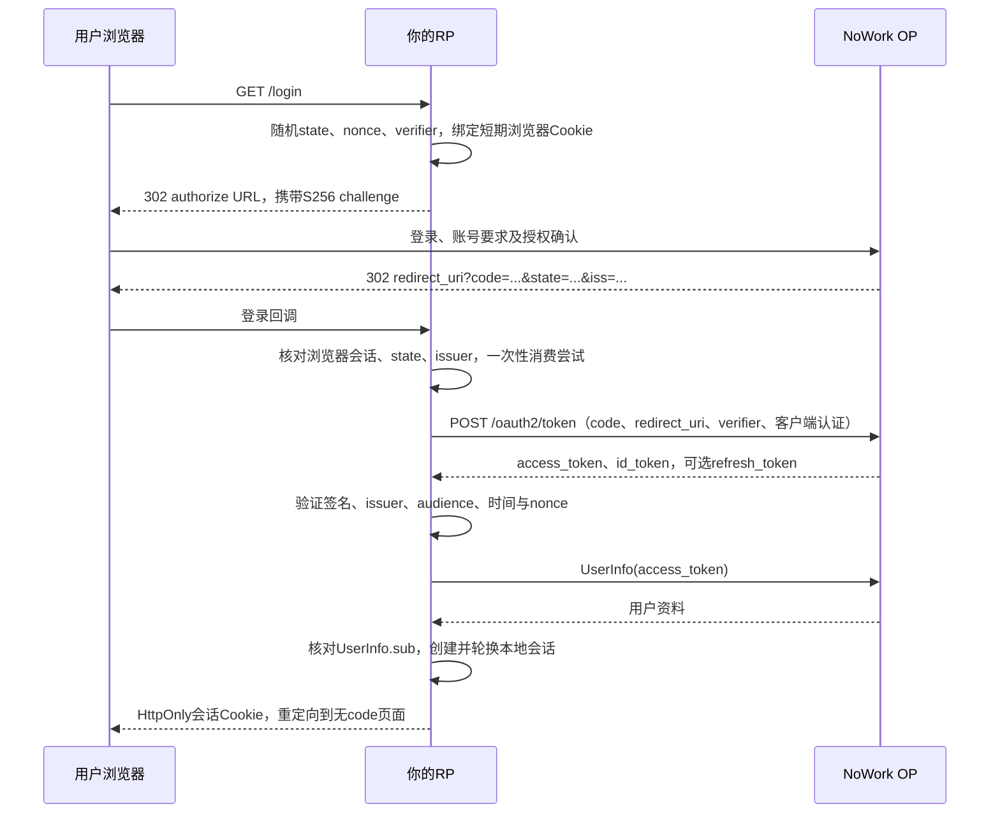

# OIDC 完整对接指南

本文面向把 NoWork 作为身份提供方的网站、启动器和原生客户端。目标是完成应用注册、授权码＋PKCE 登录、ID Token 验证、本地会话、刷新、退出和故障处理。游戏服务器进服授权另见 [游戏服指南](GAME_SERVER_INTEGRATION.md)；全部请求／响应字段见 [接口参考](API_REFERENCE.md)。

## 1. 确定角色与部署地址

NoWork 是 OpenID Provider（OP），你的应用是 Relying Party（RP）。用户在 OP 登录；RP 通过一次性授权码换取令牌，验证后建立自己的会话。RP 的后台权限仍由 RP 自己授予。

| 名称 | 含义 | 注意 |
| --- | --- | --- |
| `issuer` | 该站点身份提供方的稳定 HTTPS 地址 | 与 discovery 和 ID Token 的 `iss` 精确一致 |
| `client_id` | 后台登记的接入应用标识 | 可以公开；不等同于服务器代码 |
| `client_secret` | 机密客户端的认证秘密 | 仅在 RP 服务端保存；原生／浏览器公开客户端不使用 |
| `redirect_uri` | 登录回调 | 每次授权和换码必须与登记值一致，包括路径、端口和查询 |
| `post_logout_redirect_uri` | 退出后回调 | 单独登记；不能由任意请求参数指定外站 |
| `state` | 当前浏览器发起的登录尝试标识 | 绑定浏览器会话，短期、一次性使用 |
| `nonce` | 本次登录和 ID Token 的关联值 | 独立随机生成，验证签名后比较 |
| PKCE verifier／challenge | 授权码与发起客户端的绑定 | verifier 不进入授权 URL；只发送 S256 challenge |

多站点接入以目标站点的 issuer 为准。不要用主站 JWKS 验证另一个站点的令牌，也不要只按邮箱、用户名或裸 `sub` 把不同 issuer 的账号合并。RP 账号的外部身份键应至少是 `(issuer, sub)`。

## 2. 注册应用

管理员在接入应用管理中创建客户端；允许自助开发者管理的站点也可通过用户中心的开发者入口申请并创建。是否允许创建、可用 scopes、应用审核、回调规则由当前站点政策决定。

1. 填写应用名称及真实回调地址；开发用 loopback 地址只在部署策略允许时登记。
2. 区分机密客户端和公开客户端。公开客户端采用 `none`，必须使用 PKCE S256。
3. 机密客户端选择正确的 token endpoint 认证方式。**本仓库六语言轻量 OIDC helper 的常规换码／刷新使用表单 `client_secret_post`；使用这些默认 helper 时应登记该方式。** 若登记 `client_secret_basic` 或 `private_key_jwt`，使用匹配的 HTTP 实现／成熟 OIDC 库，不混用多种认证方式。
4. 至少授权 `openid`；只申请业务需要的附加 scopes。需要刷新令牌时申请 `offline_access`，是否发放仍由服务端决定。
5. 配置退出回调；需要全局单点退出时再登记 front-channel／back-channel 能力。
6. 保存密钥到 RP 的密钥存储，不加入版本库、浏览器包、URL 或日志。

常见字段名包括 `redirectUris`、`postLogoutRedirectUris`、`tokenEndpointAuthMethod`、`public`、`requirePkce` 和 scopes。管理接口与开发者接口的写入权限／字段集合不同；以对应 OpenAPI operation 为准，不要直接把数据库模型作为 HTTP 请求体。

## 3. 发现端点和签名公钥

```text
GET ISSUER/.well-known/openid-configuration
GET ISSUER/jwks.json
```

| 功能 | NoWork 端点 | 返回格式 |
| --- | --- | --- |
| 授权 | `/oauth2/authorize` | 浏览器重定向或登记的响应模式 |
| 换码／刷新／机器令牌 | `/oauth2/token` | OAuth JSON，非 SPA 信封 |
| 用户资料 | `/oauth2/userinfo` | 默认 JSON；可按投递配置变为签名／加密 JWT |
| 内省 | `/oauth2/introspect` | RFC 7662 JSON |
| 撤销 | `/oauth2/revoke` | 成功可为空体 |
| RP 发起退出 | `/oauth2/logout` | 浏览器退出流程 |
| 公钥 | `/jwks.json`、`/.well-known/jwks.json` | JWK Set，只包含公开材料 |

SDK 1.3.0 新增 `discover`／`JWKS` 读取：验证 discovery 的 issuer 和必要字段，限制公共 JSON 响应体为 1 MiB，保留扩展字段。它们读取**配置好的 NoWork 固定路径**，不会因为 metadata 中出现另一个 URL 就改写后续请求端点；这些 helper 不是通用的第三方 OIDC 信任发现引擎。

| 语言 | 读取 discovery | 读取 JWKS |
| --- | --- | --- |
| Go | `OIDC.Discover(ctx)` | `OIDC.JWKS(ctx)` → `[]byte` |
| Python | `NoworkOIDC.discover()` | `.jwks()` → dict |
| TypeScript | `NoworkOIDC.discover(signal?)` | `.jwks(signal?)` → `JWKS` |
| Java | `NoworkOidc.discover()` | `.jwks()` → JSON string |
| C# | `NoworkOidc.DiscoverAsync(ct)` | `.JwksAsync(ct)` → JSON string |
| PHP | `$oidc->discover()` | `$oidc->jwks()` → array |

这些 GET 不使用 client_secret 或用户访问令牌。自行注入 transport／HTTP client 时，也要保证公共请求不会被自定义中间件附加认证头或改送其他目的地。各语言超时、代理、取消和无流式适配器的限制见语言 README。

启动时或后台定期读取发现文档；按 HTTP 缓存策略缓存可信 JWKS。遇到未知 `kid` 时允许一次受控刷新再验签，不无限刷新，也不从 token 里的任意 URL 加载密钥。缓存失效、签名错误或 issuer 不匹配都不能退回“只解析 payload”。

## 4. 完整授权码流程



每次点击登录创建独立尝试。不要在全局变量中存唯一 verifier，也不要把前一个标签页的 state 覆盖给后一个标签页。回调处理过的尝试不可再次消费；错误页面、取消授权与超时同样要有明确的清理规则。

### 发起授权

标准参数如下：

| 参数 | 要求 |
| --- | --- |
| `response_type` | `code` |
| `client_id` | 登记的客户端 |
| `redirect_uri` | 登记的精确回调 |
| `scope` | 空格分隔，包含 `openid` |
| `state` | 本次浏览器会话保存的随机值 |
| `nonce` | 本次会话保存的另一随机值 |
| `code_challenge` | `BASE64URL(SHA256(verifier))`，无 padding |
| `code_challenge_method` | `S256` |
| `ui_locales` | 可选 `zh-CN zh-TW en ja` 中的语言偏好 |
| `prompt` | 可选 `none`、`login`、`consent`、`select_account`，遵循服务端约束 |
| `max_age` | 可选重新认证的最大间隔，不能当作延长会话的参数 |

用 SDK 的 URL builder 或 URL 编码库构造地址，不手工拼接未编码的回调、state、nonce。`prompt=none` 可能返回 `login_required`、`consent_required` 等结果；只有已有会话及服务端条件满足时才可静默完成。

### 处理回调

先检查本地登录尝试存在且未过期，使用浏览器会话核对 state，然后检查返回 issuer。正常或错误响应都必须与当前尝试关联。不要把任意 callback URL 查询中的 code 当作登录凭据。

用户拒绝授权时可能收到 `error=access_denied`。展示适当说明并允许重新开始；不要继续调用 token endpoint。使用 `form_post` 时回调要接收 POST，且要重新评估 SameSite Cookie 对跨站 POST 的影响；本指南及示例使用默认 query 响应模式。

## 5. 换取令牌

机密客户端使用登记的 `client_secret_post` 时，提交 `application/x-www-form-urlencoded`：

```text
grant_type=authorization_code
client_id=<登记的client_id>
client_secret=<仅RP服务端保存的secret>
code=<本次回调的一次性code>
redirect_uri=<与授权请求相同的redirect_uri>
code_verifier=<服务端会话保存的verifier>
```

这是参数结构说明，不是可直接使用的凭据。公开客户端省略 client_secret；不得把假的 secret 放进去。不要同时提交 Basic、表单 secret 和 client assertion。授权码单次消费且与客户端、回调和 PKCE 绑定；连接中断后的不确定结果不能通过无限重放同一 code 解决。

```json
{
  "access_token":"opaque-or-jwt-access-token",
  "token_type":"Bearer",
  "expires_in":3600,
  "id_token":"signed-or-encrypted-id-token",
  "refresh_token":"optional-rotating-refresh-token",
  "scope":"openid profile offline_access"
}
```

上例说明字段，不代表固定有效期或必然发放 refresh_token。`expires_in` 是秒数；本地过期时间用收到响应时的实际时刻计算。不能用 access_token 是否能 Base64 解码判断它有效。

## 6. 验证 ID Token，绑定本次登录

验证顺序：

1. 若启用了 JWE，先用 RP 私钥解密，再验证内层签名 JWT；加密不是身份签名的替代。
2. 固定接受应用支持的签名算法。NoWork 当前 ID Token 使用 RS256；不接受 `none` 或把 RSA 公钥当 HMAC 密钥。
3. 使用可信 issuer 的 JWKS 和 `kid` 验证签名。
4. 精确核对 `iss`，核对 `aud` 包含自己的 client_id，并检查适用的 `azp` 规则。
5. 验证 `exp`、`nbf` 和应用自己的认证新鲜度策略；SDK helper 的既有时间容差是 60 秒。
6. 核对签名内的 nonce 与本次会话保存值一致；缺失、非字符串、错误或明确传入空 expected nonce 都拒绝。
7. 要求可用的 `sub`。若随后读取 UserInfo，其 `sub` 必须与已验证 ID Token 相同。

新 nonce API：

| 语言 | 推荐调用 |
| --- | --- |
| Go | `VerifyIDTokenWithNonce(token, jwks, issuer, clientID, nonce, now)`；加密用 `DecryptIDTokenWithNonce` |
| Python | `verify_id_token(..., issuer=..., audience=..., expected_nonce=...)`；`decrypt_id_token` 同样传入 expected_nonce |
| TypeScript | `verifyIdToken(token, jwks, {issuer, audience, expectedNonce})`；`decryptIdToken` 传同一 options |
| Java | `NoWorkDelivery.verifyIdToken(token, jwks, issuer, audience, expectedNonce)`；加密用 `decryptIdTokenWithNonce` |
| C# | `NoWorkDelivery.VerifyIdToken(token, jwks, issuer, audience, expectedNonce)`；加密用 `DecryptIdTokenWithNonce`，见 C# README |
| PHP | `Delivery::verifyIdToken(token, jwks, issuer, audience, expectedNonce)`；加密方法同样携带 expectedNonce |

Python 的 expected_nonce=None 也表示未启用额外检查；PHP 明确传入 null 会被拒绝。安全登录始终传本次生成的非空 nonce。旧调用未传 expected nonce 时保留兼容行为，**不能把它当作已经完成 nonce 校验**。issuer 和 audience 在部分低级 helper 中可省略，但登录代码必须提供。SDK helper 不替应用保存 state、不创建浏览器会话，也不自动实现全部 OIDC 策略；多 audience／azp、`max_age/auth_time`、可选哈希等高级校验需按所用流程执行，或交给成熟 OIDC 库。

加密运行条件也要核对：Go／Java 使用标准库；Python 的签名／JWE helper 需要可选 `cryptography`；TypeScript 使用 Web Crypto（Node 18 的验证测试需 `--experimental-global-webcrypto`，或使用内建支持的较新运行时）；C# 支持 RSA／P-256，不支持 X25519；PHP 按算法需要 OpenSSL／sodium，且其 JWE 算法集合有差异。缺少加密依赖时应阻止登录验证，不能跳过验签。

## 7. 读取资料并建立本地会话

`GET /oauth2/userinfo` 使用 `Authorization: Bearer <access_token>`。默认 UserInfo 是普通 OIDC JSON，没有 `code/data` 信封。

| Scope | 常见资料 |
| --- | --- |
| `openid` | `sub`，OIDC 身份语义 |
| `profile` | 名称、用户名、头像等已允许资料 |
| `email` | 邮箱及验证状态 |
| `phone` | 电话及验证状态，仍受数据投递和隐私政策限制 |
| `security_level` | 信任等级；不直接等于你的应用管理员 |
| `realname` | 实名状态；不等于获取证件姓名或证件号码 |
| `game_roles` | 已释放的游戏角色；不等于创建角色绑定 |
| `offline_access` | 请求离线访问／刷新能力，仍取决于服务端策略 |

可用 scopes 和 claims 以 discovery、客户端授权范围及投递配置为准。用户拒绝权限、字段未验证、隐私设置或 pairwise 配置都可能导致字段缺失；不要把空邮箱当作用户不存在，也不要通过缺失可选字段触发自动提权。

验证成功后映射 `(issuer, sub)` 到本地账号，轮换本地会话 ID，设置 HttpOnly／Secure／适当 SameSite Cookie，并立即跳到不包含 code 的页面。除非应用确实需要后续 API 调用，否则不要长期保存 access_token；refresh_token 在服务端加密存储。日志、分析脚本和错误追踪不得记录令牌、code 或 verifier。

## 8. 可运行的 RP 示例

完整代码和测试位于 [examples/oidc-rp-go](../examples/oidc-rp-go/README.md)。它使用仓库内 Go SDK，演示浏览器绑定的 PKCE/state/nonce、ID Token 验证、UserInfo.sub 校对、本地会话和退出，不需要任何真实凭据即可运行 mock-provider 测试。

在 SDK 目录中验证示例：

```powershell
Push-Location examples/oidc-rp-go
go test ./...
go vet ./...
Pop-Location
```

连接真实测试站点时，按示例 README 设置 issuer、客户端、回调和 Cookie 部署参数，然后访问它的 `/login`。示例的内存会话适合单进程演示；多副本环境改用共享且有 TTL 的事务存储，并保持一次性消费和会话绑定约束。它不是“下载后无需配置即可连接任意生产实例”的承诺。

## 9. 刷新、内省与撤销

- 刷新：`grant_type=refresh_token`。收到成功响应后原子替换本地 refresh_token；不要让同一账号的多个并发请求同时使用旧 refresh_token。
- NoWork 会轮换刷新令牌，重放可能撤销整个家族；滑动有效期不突破绝对有效期和原会话期限。用户状态或强制操作变化也可能使刷新返回 invalid_grant，此时重新授权。
- 内省：以正确的客户端认证调用 `/oauth2/introspect`，检查 `active`。它不能作为不受限制的跨客户端 token 查询服务。
- 撤销：调用 `/oauth2/revoke`。空成功响应是合法的；不要把空体误判为 JSON 损坏。令牌撤销和清除自己的浏览器会话是两件都需要处理的事。
- `client_credentials` 面向机器，不产生终端用户登录会话，不能据此建立玩家或用户的本地登录。

## 10. 退出与单点退出

RP 本地退出先清理自己的会话，再按业务需要引导浏览器到 `LogoutURL`。带上登记的 post_logout_redirect_uri、独立的退出 state，以及适用的 id_token_hint；回到 RP 后核对退出 state。

NoWork 的退出流程可能需要浏览器确认，不应把 GET 登出地址当成不需要用户上下文的“强制全站注销 API”。front-channel 通过浏览器通知 RP，back-channel 使用签名 logout token；接收方需按对应规范验证 issuer、audience、签名、时间、事件和重放，并以 sid／sub 定位本地会话。

旧 helper 的 `LogoutURL` 只构造 URL，不自动实现退出 token 接收器或持久会话注销。退出 token 的验证规则与 ID Token 不同，不能盲用要求 exp/nonce 的 ID-token helper。动态注册、会话治理与退出详情见 [项目指南](PROJECT_INTEGRATION.md) 和完整 OpenAPI 的 `sso-contracts` 分组。

## 11. SDK 登录页、原生客户端和高级配置

游戏客户端可使用品牌登录页 `/sdk/login/{serverCode}`，与标准授权码换码端点共用 OIDC 客户端。登录页需要服务器审核、模块开关、客户端和精确回调白名单；PKCE S256 必填。回调解析、登录码和 postMessage 见 [PROTOCOL §6](PROTOCOL.md#6-sdk-登录页游戏客户端登录2026-09-28)，四语模板事件见 [LOGIN_TEMPLATES](LOGIN_TEMPLATES.md)。

原生客户端使用公开客户端，优先外部系统浏览器和登记的应用链接／回环回调；不要把 client_secret 编进安装包。NoWork 自有原生 App 的设备证明、App approval 和 `X-Native-*` API 是另一套协议，不能用普通 OAuth token 冒充，见项目指南。

| 高级能力 | 后端能力 | SDK 接入边界 |
| --- | --- | --- |
| `private_key_jwt` | 支持登记的 RS256／ES256 客户端断言，含 endpoint audience 与 jti 防重放 | 默认 OIDC helper 不自动构造断言，使用匹配实现 |
| 动态客户端注册 | 按站点政策开放 `/oauth2/register`，可能需 initial access token／审核 | 不假定公共任意注册；按返回 management 凭据管理 |
| pairwise subject | 投递配置按 sector 隔离 sub | 使用实际 `(issuer,sub)`；跨应用相同 uid 不能替代 consent |
| 加密 ID Token | 先 RS256 签名，再按 RP 公钥 JWE 加密 | 使用支持该 alg 的私钥和 nonce-bound 解密验签入口 |
| 签名／加密 UserInfo | `application/jwt`，按投递配置启用 | 默认 `.UserInfo()` 处理 JSON；JWT UserInfo 使用匹配 JOSE 实现，不当成普通 ID Token |
| JAR／任意 claims 请求 | 当前 discovery 声明 request/claims 参数不支持 | 不发送未支持的参数并假定已生效 |

算法、密钥轮换、属性映射、pairwise 与权益见 [DELIVERY](DELIVERY.md)。PHP 等语言的 JWE 算法支持和可选加密依赖与其他语言不同，需先核对语言 README。

## 12. 错误排查和验收

| 现象／错误 | 核对内容 | 恢复方式 |
| --- | --- | --- |
| discovery issuer mismatch | 配置地址、站点、反代 Host、末尾路径 | 修正可信 issuer，不跳过检查 |
| 回调 state 缺失／不同 | Cookie SameSite、域名、会话存储、多标签页 | 丢弃回调并发起新登录 |
| invalid_client | 登记认证方式、client ID/secret、断言／重复认证参数 | 修复配置，不循环重试密码 |
| invalid_grant | code 重放／过期、redirect、PKCE、refresh 重用或账号要求 | 完成要求后重新授权 |
| invalid_scope | 请求范围超出客户端和站点政策 | 重新申请必要且允许的范围 |
| nonce mismatch | 使用了错误尝试的 nonce／token，或未请求 nonce | 拒绝，不建立本地会话 |
| 签名／kid 错误 | issuer、缓存、公钥轮换、算法 | 最多一次受控刷新 JWKS 后重验 |
| UserInfo.sub 不同 | 混用了别次会话的 access_token 与 id_token | 拒绝并清除该登录尝试 |
| 解析 UserInfo JSON 失败 | 是否配置了签名／加密 UserInfo或代理返回 HTML | 使用对应媒体类型处理器 |
| 429／5xx／超时 | 限流、网络、OP 服务及密钥读取健康状态 | 受控退避；不无限重放一次性凭据 |

验收至少覆盖：成功登录、取消、state/issuer/nonce/sub 不匹配、错误签名和 audience、过期 token、旧码重放、错误 verifier、并发刷新、未知 kid 轮换、本地退出以及回调页面无 token 泄露。时间检查使用实际 Unix 秒，不随浏览器时区加减；操作系统时钟需正常同步。

本文依据当前后端 OAuth／session／client-auth／delivery／SSO 实现及 SDK 测试。真实站点的客户端审核、密钥和反向代理仍需实际联调；已执行的本地验证与限制见 [VERIFICATION](VERIFICATION.md)。
