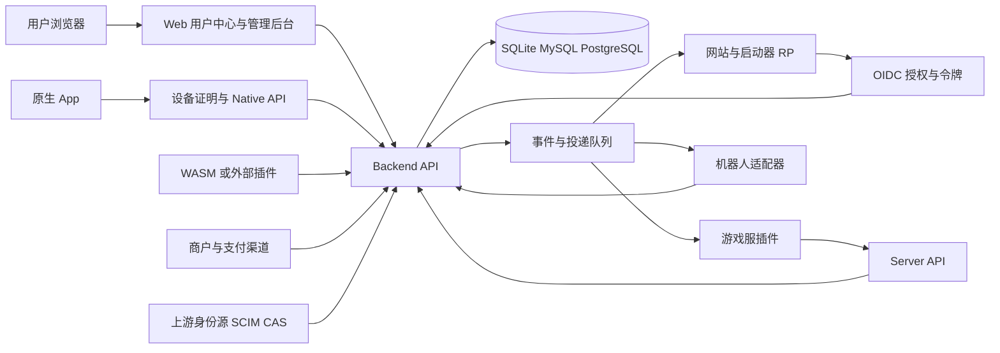

# 整个项目的对接总指南

本指南用于规划和实施 NoWork 用户中心与网站、游戏服、启动器、原生 App、机器人、商户、身份系统及插件的集成。它说明各系统如何连接、哪些凭据能调用哪些接口、如何处理状态和数据，以及怎样部署和验收。

完整机器契约已随 SDK 保存，可离线使用：当前 **1,623 个源码注册操作＋6 个仅保留文档的弃用操作、1,368 个数据结构**。所有字段、限制、响应和鉴权说明见 [接口索引](API_REFERENCE.md) 与 [OpenAPI 快照](reference/openapi.json)。不要把管理接口快照放入 Web 的公开静态目录。

## 1. 系统边界和接入顺序



建议按以下顺序推进：确定站点和身份边界 → 部署用户中心并完成安装 → 创建最小权限的接入对象 → 跑通一个读请求 → 完成一条完整业务链 → 验证拒绝、重试和撤销 → 接入监控与运维。不要先把超级管理员会话交给所有外部系统再补权限。

| 目标 | 首选入口 | 实施指南 |
| --- | --- | --- |
| 游戏服进服、白名单、GM、玩家数据 | Server API＋服务器密钥 | [游戏服完整指南](GAME_SERVER_INTEGRATION.md) |
| 网站／启动器统一登录 | OIDC Authorization Code＋PKCE | [OIDC 完整指南](OIDC_INTEGRATION.md) |
| 用户门户和玩家自助操作 | 当前用户会话的 account API | [ACCOUNT_API](ACCOUNT_API.md) |
| 自己的后台自动化 | 有限范围 API Key 或明确的后台会话 | 本文第 8 节和接口 scope 目录 |
| 框架机器人 | Bot API／专用客户端 | [BOTS_SDK](BOTS_SDK.md) |
| 游戏／网页聊天 | 聊天票据、Chat 会话、REST／WS | [CHAT](CHAT.md) |
| 服务内扩展或外部插件 | 插件清单、ABI、专用 token | [插件 SDK](../plugins/README.md) |
| 数据字段、权益、加密投递 | Delivery profile／Webhook | [DELIVERY](DELIVERY.md) |
| 自有手机 App | OAuth 登录后绑定设备公钥，使用 Native API | 本文第 12 节及 `modules/apps` 契约 |

## 2. 工程、构建和部署

工作区由 `Backend/`、`Web/`、`SDK/` 独立仓库组成。SDK 的运行时下限不等于后端／前端构建要求：后端当前使用 Go 1.26；Web 使用 Vue 3、Vite 7 和支持其要求的 Node.js（例如 22.12+ 的维护版本）；各 SDK 下限见 [README](../README.md)。

### 本地开发

在完整工作区中先按 Backend 配置说明启动后端，再在 Web 执行依赖安装和 `npm run dev`。通常后端为 `http://localhost:8081`、Web 为 `http://localhost:5173`，前端开发代理的目标要与实际后端一致。首次未安装实例进入 `/install`，通过安装令牌完成站点、数据库和首个管理员设置。

安装令牌来自后端启动日志或数据目录的 setup-token，只给安装操作者使用。生产实例不要依赖示例管理员密码，也不要把开发模式验证码、SQL 调试或任意来源 CORS 带到公网。

### 生产部署

1. 构建 Backend 二进制和完整 Web/dist；也可使用根工作区 `docker/` 的安装脚本和 compose 配置。
2. 持久保存配置、数据库、上传、加密私有文件、签名／加密所需材料和安装锁。容器重建不能清空这些数据。
3. 设置正确的 `server.baseUrl`、`server.frontendUrl`、`oidc.issuer`；后端托管前端时配置 `server.webDist`，反代托管时分别处理静态文件和接口。
4. HTTPS 反代覆盖 `/api/`、`/oauth2/`、`/server/`、`/.well-known/`、`/jwks.json`、上传和需要的 WebSocket 路径。API 不回退成 index.html。
5. 配置实际可信代理，核对转发后的 Host、Origin、客户端 IP 和 HTTPS 判断。不要把所有来源都当可信代理。
6. 用 `/healthz` 核对实际进程、数据库和时钟。metrics、环境信息、开发文档、备份入口按其权限和网络范围暴露。
7. 验证备份恢复和当前配置对应的密钥可用，再接入真实用户。

SQLite 适合单实例部署；多副本时使用合适的共享数据库，并核验会话、nonce、事件 claim、定时任务和存储的跨进程语义。SDK 示例内存缓存／会话不能直接作为多副本一致性方案。

## 3. 地址、站点与身份标识

| 值 | 用途 | 禁止混淆 |
| --- | --- | --- |
| issuer | OIDC 身份域和签名信任来源 | 不等同于任意前端 URL |
| siteId | 请求所属站点／租户 | 不能由普通调用者任意传入来跨站访问 |
| userId | 后端内部账号行 ID | 不等于对外 UID、OIDC sub 或第三方平台 ID |
| UID | 用户中心公开账号编号 | 仅在接口允许时作为参数 |
| `(issuer, sub)` | RP 外部身份键 | pairwise sub 不能跨应用推断同一用户 |
| serverId／serverCode | 数字管理 ID／稳定服务器代码 | 不能替代服务器密钥 |
| roleId／roleName／roleUuid | 本地绑定记录／游戏身份 | 不能用上游 UID 代替资料 API 要求的绑定 ID |

站点可共享身份或使用独立身份池；共享身份不意味着角色、应用、玩家数据、账本或管理员权限共享。服务器密钥会绑定其所属服务器和站点，OAuth 客户端绑定其注册的 issuer。跨站访问和平台身份中继必须走专门流程，不能靠改 Host、siteId 或 UID 达成。

## 4. 凭据和授权模型

| 凭据 | 常见传递方式 | 能力边界 |
| --- | --- | --- |
| 用户中心浏览器会话 | `Authorization: Bearer <site JWT>` | 当前账号＋站点＋实时角色与数据范围 |
| OIDC access_token | OAuth UserInfo／接入应用资源 | 该 OAuth 客户端与 scopes；不自动成为后台 API 会话 |
| OIDC ID Token | RP 登录验证 | 证明认证结果；不是通用 API 调用密钥 |
| 服务器密钥 | `X-Server-Key` | 一台服务器的 Server API |
| API Key | `Authorization: Bearer lk_v1_...`，可附 HMAC | 显式 scopes 与创建者当前权限的交集 |
| Native access／refresh | Bearer `nsa_...`／`nsr_...`＋设备签名 | App、站点、设备、scope 和会话族 |
| Chat token | `Authorization: Chat <token>`／WS 首帧 | 聊天会话与允许频道 |
| Bot token | `Authorization: Bot <token>` | 单个机器人和已启用能力 |
| 外部插件 token | `X-Plugin-Token` | 已同意的插件权限、能力及站点范围 |
| Webhook／Bot push 密钥 | 验证回调签名 | 验证该回调来源；不能登录 API |
| 管理访问／受限 setup 凭据 | 各流程返回的专用凭据 | 只完成明确允许的访问／补全过程 |

后端会在请求时检查账号状态、权限、数据范围、站点、应用政策、模块开关和授权撤销。前端隐藏按钮不代替后端鉴权；历史上持有超管角色也不保证某个专用凭据可访问超管接口。角色模板、范围授权和恢复操作应通过正式管理 API 执行。

## 5. HTTP、响应、分页与更新

普通 SPA／Server API 常用信封：

```json
{"code":0,"message":"操作成功","data":{"list":[],"count":0}}
```

先处理 HTTP 网络／状态错误，再处理业务 code。HTTP 200 不等于成功。OAuth、商户协议、SCIM、文件下载和 WebSocket 有各自协议，不能一律包成 `code/data`。

常见 code 为 401（凭据失效）、403（权限／来源／范围拒绝）、409（版本／并发冲突）、428（需要完成账号操作）、429（限流）等。管理员绑定要求、首次资料等还有专用业务码与 route／checklist；按返回的受支持流程处理，不把所有错误都当作清除全站会话的理由。

分页不是全项目统一参数：很多列表用 `page/limit → list/count`，另一些用 cursor、before/after 或 pageSize。字段以每个 operation 为准。清空、忽略和删除也要区分：`null`、空字符串、空数组、省略字段在不同接口有不同含义。

有 `version`／revision 的修改使用服务端刚返回的版本；409 后重读、显示冲突并合并，不能去掉版本字段强行覆盖。批处理需逐条读取结果，部分失败不能显示全成功。

## 6. 登录、账号要求和资料

用户登录可能经过密码／验证码、MFA、passkey、外部身份、App 审批、强制绑定、首次资料或法律同意。不要因为前一步返回某个 token 或 challenge 就假定已得到完整站内权限。

集成客户端需要保留当前流程的 state、challenge、nonce、PKCE 和返回地址，只跳转到该流程允许的补全入口。受限 setup/native/API-key 凭据不会因为客户端把它当普通 JWT 就获得完整会话能力。

资料、自定义字段、实名状态和游戏角色由不同模块管理。`realname_verified` 只表示服务端授予的状态；证件照片和私人附件通过受鉴权的私有文件通道读取，不能公开放到 `/uploads`。公开资料字段仍受站点配置和用户可见性选择影响。

上游 OIDC／OAuth／平台扫码登录是 NoWork 获取外部身份的方式，与 NoWork 向你的 RP 签发 OIDC 令牌不同。LinuxDO、QQ、米游社、森空岛等各有能力、区域、审核和资料字段；未知或不可用的数据必须保留真实状态，不能填造成功资料。

## 7. 游戏、角色、资料与 GM

按 [游戏服指南](GAME_SERVER_INTEGRATION.md) 完成进服判定和心跳。玩家本人入口和服主入口分开：`/api/account/portal/...` 用于玩家门户，`/api/account/servers` 是服主控制台，不要以“返回了服务器列表”为理由混用权限。

独立角色 GM SSO、SDK OAuth 登录和 GM 指令下发分别对应身份兑换、账号认证和操作授权。roleId、服务器代码、UID、上游角色 ID 必须使用接口实际要求的值。游戏资料 API 还检查提供方绑定、授权范围、数据可见性和缓存来源；静态游戏素材目录不包含玩家账号资产。

Go／Python／TypeScript 的 AccountClient 只封装部分门户／聊天操作；六语言 GameDataClient 及 Server API 的能力矩阵见 [SDK README](../README.md)。没有封装的方法按完整契约直接调用，不能根据某个语言有方法就推断全部语言同样支持。

## 8. API Key 自动化与 HMAC

使用完整浏览器会话查看 `GET /api/account/api-keys/scopes`，选择允许的精确方法／路由，再创建 personal 或 service key。管理员不能通过此机制随意为其他用户铸造新凭据。创建、修改、轮换及敏感操作保留密码／MFA 确认要求。

API Key 完整 token 只显示一次。有效权限是 key scopes、创建者当前权限、站点成员关系及其他政策的交集；不可用来创建更多凭据、获得超管能力或绕过未开放给 key 的路由。IP、Origin、配额和有效期也会检查；配置了 Origin 白名单时，缺少 Origin 的 CLI 请求同样可能被拒绝。

启用 `requireHmac` 后额外发送：

```text
X-API-Key-Timestamp: 十进制 Unix 秒
X-API-Key-Nonce: 每次唯一的 16–96 位 URL-safe ASCII 随机值
X-API-Key-Signature: 小写十六进制 HMAC-SHA256
```

使用**完整 API Key token**作 HMAC 密钥，将以下八段 UTF-8 文本用一个换行连接：

```text
lk-v1
大写METHOD
准确转义路径及原始query
小写Host（保留显式端口）
timestamp字符串
nonce字符串
SHA256_HEX(原始body字节)
Origin原值（没有则为空）
```

空 Origin 作为最后一段时，连接结果自然以换行结束；除此之外不加额外尾部换行。时间窗为服务器时间前后五分钟；每次重试生成新请求 nonce，业务幂等键按业务保持。不要重排签名后的 query、重新序列化 body，或把 body 的文字编码和发送字节分开处理。完整凭据、请求证明和业务幂等 ID 是三个不同概念。

## 9. Webhook、事件和异步处理

管理员 Webhook 和开发者自己应用的 Webhook 分开管理。开发者只能处理自己应用、当前站点和允许的事件，不能通过自定义 userId 订阅其他人的完整资料。

通用 Webhook 用事件 ID 幂等；签名覆盖原始 body 和时间戳；JWE 先验外层签名再解密核对绑定关系。先持久接收／幂等标记，再尽快响应，耗时业务进入自己的工作队列。未返回成功可能触发重试，重试不保证全局顺序。

回调失败不能凭空补出“执行成功”。记录结果不确定、可重试、永久失败的区别，保留事件／命令 ID。游戏中继 ACK 的 `done/failed`、Bot ACK 的 `ids` 和 Webhook HTTP 2xx 不可混用。完整协议和可运行接收端见 [DELIVERY](DELIVERY.md)、[CHAT](CHAT.md) 与 [示例](../examples/README.md)。

## 10. 机器人与聊天

机器人实例发送 `Authorization: Bot <token>`（也接受受支持的 Bearer 形式）。它不是普通用户或超管会话；平台绑定码将真实平台用户与用户中心账号关联，平台事件仍需验证自己的来源。

Bot 通知可通过 `/api/bot/v1/events` WebSocket／轮询接收；处理成功再 ACK。应用层 ping/pong 与 WebSocket 控制帧不同，按服务端 hello 的 heartbeat 发送。HTTP push 有自己的签名密钥、事件名和投递 ID校验。NoneBot2、Koishi、Wechaty 的配置、消息转换和降级行为见 [BOTS_SDK](BOTS_SDK.md)。

聊天会话是单独的 Chat token，游戏票据一次性兑换。WebSocket `/api/chat/ws` 要在首帧认证，不把 Chat token 放到查询串；Bot WebSocket 在不能设置请求头时的 token 参数是另一个协议的例外，不可照搬。消息 nonce 在同一条业务消息重试时保持一致，新消息重新生成。

## 11. 支付、钱包、商户与会员

区分三层：用户的订单／钱包接口、管理员的渠道／对账接口、商户协议兼容入口。商户应用需要自身凭据和审核；OIDC 用户登录令牌不等于商户签名密钥。

由配置／价格接口读取当前币种、精度、限制和产品信息，创建真实订单，再依靠签名通知或服务端查询确认付款。浏览器 return URL、截图和“支付按钮被点击”都不是付款成功证据。退款、争议和结算保留各自状态与幂等约束。

金额按对应接口规定的整数最小单位或精确字符串处理，不用二进制浮点做付款金额运算；JSON 64 位数超出 JavaScript 安全范围时使用能精确保留的解码／数据类型。订单号和 tradeNo 是不同系统的标识，回调要核对商户、订单、金额、币种和签名。

`/api.php`、`/submit.php`、`/alipay/gateway.do` 等是自托管的协议兼容入口，不能误当成支付宝官方服务。只使用后台返回的网关地址、实际已实现协议和凭据；完整字段和签名规则见 `merchant-protocol` 契约。

会员试用、订阅、续费和 recurring mandate 属于会员域。定期扣款需要明确同意和实际提供方能力；不要用普通产品订单伪造自动续费授权。积分、钱包余额、会员权益、应用 entitlement 是不同的数据，不用“已付款”直接授予任意管理员角色。

## 12. 原生 App 和设备证明

自有 App 先走登记的公开 OAuth 客户端＋PKCE，再按 App 政策申请 Native 凭据。原生 API 主要位于 `/api/app/v1/*`，还会复用明确开放给 native scope 的部分 account API。它不是把浏览器 JWT 长期塞进 App 的方案。

`POST /api/app/v1/native/token` 使用 OAuth access_token 和设备 Ed25519 证明，绑定账户、client、App、站点、scope 与设备公钥。deviceId 使用随机安装标识，不使用硬件序列号或广告 ID。返回 `nsa_` access 和可选 `nsr_` refresh；没有 offline_access 时不能假定会发刷新凭据。

每次原生请求对以下**紧凑 UTF-8 JSON 字符串数组**签名：

```text
["sakura-native-request-v1",issuerWithoutTrailingSlash,clientId,deviceId,HTTP_METHOD,exactRequestURI,exactContentType,sha256hex(rawToken),sha256hex(rawBodyBytes),timestampString,nonceString]
```

所有时间戳等元素按协议为字符串，数组无多余空格或换行。URI 包含原始路径与 query，Content-Type 与实际请求完全一致，body 必须先序列化一次再计算哈希并发送原字节。Go 等编码器要处理好 HTML／Unicode 转义一致性，并与后端 golden vector 核对。

发送 `X-Native-Timestamp`、`X-Native-Nonce`、`X-Native-Signature`；Ed25519 签名和公钥使用无 padding 的 base64url，时间容差为 ±60 秒，nonce 每次独立且为 22–128 字符。Native 签名、API Key HMAC、Webhook HMAC 完全不同。

刷新仍用完整证明，旧 refresh 重用会影响会话族。敏感凭据操作还可能需要浏览器生成的 credential approval；App approval 要绑定具体操作、设备与正文哈希。任何 native scope 都不会自动开放整个 `/api/admin/*`。设备撤销、App 发布／安全策略、push token、实时连接、支持报告和错误状态都见 `modules/apps` 的完整契约。

## 13. 身份源、联邦、SCIM、CAS 与 SSO

上游身份源配置在 NoWork 作为 RP 的一侧；应用使用 NoWork OIDC 在 OP 的另一侧。身份绑定是持久关系，不能仅凭同名账号或昵称替用户绑定／合并。

SCIM／签名 provisioning connector、组到本地角色的映射、同步任务及重试使用 connector 专用协议和权限。同步需要稳定 external ID、幂等 upsert、停用／删除语义、组映射和范围检查；同步一个账号成功不表示可以给它任意角色。

CAS service ticket、反向代理鉴权、应用启动器和浏览器 SSO grant 也有独立 audience／service／一次性条件。不要把 CAS ticket 当 OAuth code，或把应用启动 URL 缓存为长期登录链接。SSO 会话和上游平台 token 的撤销不会自动等价于第三方 RP 自己的会话注销，双方都要实现明确的生命周期。

选用 `federation-contracts`、`sso-contracts`、`modules/identity-access` 分组中的实际端点与 schema。身份访问中继只释放配置允许的身份源和字段；敏感凭据与原始上游 profile 不应由应用通过普通资料接口取得。

## 14. 运行时插件与主题／页面扩展

运行时插件有声明式、WASM、external 三种；业务模块编译进 Backend，是另一个扩展层。不能把上传 JavaScript 当成自动拥有后台权限的插件。

插件声明 `permissions` 和 `capabilities`，管理员安装时确认；已签名不表示自动获得全部权限。WASM 宿主调用按 ABI、资源上限和授权执行；外部插件接收签名事件并以专用 token 回调。升级、撤回、发布者钥轮换、包签名和市场索引分别管理，见 [MANIFEST](../plugins/MANIFEST.md)、[ABI](../plugins/ABI.md)、[发布说明](../plugins/PUBLISHING.md)。

主题包、Page Builder、文字覆盖和 SDK 登录模板采用各自版本和发布流程。只使用允许的 CSS、插槽、组件和沙箱桥；配置内容、模板 locale 事件和用户输入是数据，不应当成不受限脚本执行。语言切换不得清空正在进行的登录／MFA／授权状态。

## 15. 自定义数据、工单、审核和自动化

自定义字段有 schema、版本、发布可见性和私有文件规则；导入先 dry-run，再确认执行结果，不能把部分成功视为整批提交成功。

服务器申请、开发者访问、应用、实名等审核共享基础设施但使用不同的业务 kind。外部审核回调只能作用于绑定的请求；结果要经实际业务授予逻辑，不能仅更新前端显示的 status。

工单具备公开回复／内部备注、附件、关闭／重开和管理员范围。申请引用工单时仍检查申请对象与当前身份。Help Center、内容页、公告和通知是不同面向的内容系统，不互相替代权限验证。

自动化先读取实际动作／触发器目录，再保存有版本的工作流；执行结果、幂等 receipt、延迟任务和重试都以服务端状态为准。不要把“预览成功”作为真实执行凭据，也不通过工作流表达式绕过动作原有权限。

## 16. 时间、语言、隐私与数据生命周期

浏览器 Web 会通过 `X-Time-Zone` 告诉 `/api/*` 当前 IANA 时区，后端按请求转换展示副本并返回相应 Vary；不修改全局时区或 Unix 时刻。SDK 的 OIDC／Server API 签名和时间窗不因此平移。直接提交预约／到期时间使用带偏移的 RFC3339，不把无来源时区的历史字符串当作 UTC 猜测转换。完整规则、已有修复和更新要求见 [时间协议](TIME_HANDLING.md)。

界面语言通过 `X-Lang`、Accept-Language 或端点支持的参数传递。程序分支依赖错误码、状态和枚举，不依赖翻译后的 message。用户自己写的昵称、备注、页面正文不会因为界面语言切换就被当作词条替换。

地区、身份源授权、资料公开、通知偏好和法律同意是独立的条件，不能从 IP／浏览器语言擅自推断用户已同意。数据导出和注销属于高敏感、可有冷静期的流程；用户数据删除需要同时考虑绑定、通知、附件、账本审计、外部系统副本和保留义务。

## 17. 密钥与故障恢复

| 材料 | 轮换／恢复原则 |
| --- | --- |
| 服务器/API Key | 通过对应接口轮换，按服务端规则处理旧钥重叠／失效 |
| OAuth client secret | 更新 RP 和 OP 配置，考虑在途请求，不写入前端 |
| OIDC 签名钥 | 通过 JWKS 分发公开部分，RP 处理 kid 与缓存轮换 |
| RP JWE 私钥 | 先部署新旧私钥，再切 OP 公钥，保留足够重叠期 |
| Webhook／Bot push 密钥 | 接收方与发送方协调更换，保留幂等和时间窗 |
| 后端 `jwt.secret` 等加密根材料 | 可能关联已存凭据和私有数据解密；不能当作普通 token 随意替换 |

备份要能恢复数据库与匹配的配置／密钥／私有文件，且需要实际恢复演练。恢复旧库可能让已撤销凭据或已处理事件再次出现，必须规划恢复点后的撤销、幂等和外部对账。

## 18. 运行监控与问题定位

监控健康状态、数据库连接、请求错误率与延迟、认证拒绝／续期、游戏心跳、队列积压、重试、投递失败和过期会话。监控／性能／GeoIP／网络诊断模块提供的是受权限控制的工具，不是外部调用者可以任意执行 SQL 或远程扫描的入口。

排查顺序：确认请求真正到达目标进程和站点 → 核对 HTTP、媒体类型、业务 code → 核对凭据类别、权限与账号状态 → 检查参数／版本／时间 → 检查队列和外部提供方。避免先关闭验签、权限、来源限制或 TLS 校验来“恢复可用”。

时间问题先比较 `/healthz` 响应体的实际时刻与系统 UTC；日志创建时间、构建时间、进程启动时间和页面快照各有不同含义。浏览器时区变化只能改变显示，不能纠正错误的服务器系统时钟。

## 19. 按业务域查找完整契约

| 业务域 | OpenAPI 分组 |
| --- | --- |
| 登录与账户 | `auth`、`account`、`modules/login-policy`、`modules/forced-actions`、`modules/onboarding` |
| 权限、凭据与安全恢复 | `account/api-keys`、`account/permissions`、`admin/permissions`、`system/permissions`、`admin/account-security` |
| OIDC 与应用 | `oidc`、`devportal`、`oidc/registration`、`admin/oidc-policy`、`modules/sdk-login` |
| 游戏与玩家 | `server-api`、`modules/server-owner`、`modules/server-users`、`modules/server-gm` |
| 上游游戏数据 | `modules/mihoyo`、`modules/hypergryph`、`modules/game-archive`、`modules/game-assets` |
| 支付、会员与权益 | `payments`、`admin/payments`、`merchant-protocol`、`membership`、`modules/payment-risk`、`modules/points`、`modules/delivery` |
| 内容与用户服务 | `modules/profile`、`modules/custom-fields`、`modules/tickets`、`modules/helpcenter`、`modules/messages`、`modules/review` |
| 事件与自动化 | `admin/webhooks`、`account/developer-webhooks`、`modules/automation`、`modules/bots`、`modules/chat` |
| 原生 App | `modules/apps` |
| 租户、品牌与扩展 | `modules/sites`、`modules/branding`、`modules/plugins`、`modules/pluginmarket`、`modules/theme-packages`、`modules/pagebuilder`、`modules/textoverrides` |
| 联邦、平台与 SSO | `federation-contracts`、`sso-contracts`、`modules/platformlogin`、`modules/identity-access`、`modules/binding-policy` |
| 运营、隐私与观测 | `modules/legal`、`modules/regional-services`、`modules/telemetry`、`modules/monitor`、`modules/performance`、`modules/netdiag`、`modules/outboundproxy` |
| 导入、审计与系统 | `modules/user-bulk`、`modules/user-audit`、`modules/batch-operations`、`modules/media-library`、`system-module`、`admin/system`、`install` |

其他分组和全部 operation 都在 [接口索引](API_REFERENCE.md) 中；原始摘要沿用后端契约语言，以免翻译改变字段或权限含义。六个仅保留文档的弃用接口已经标识，不应作为新集成入口。

## 20. 联调验收和交付

1. 每个调用方有独立、正确类别的凭据；跨账号、跨站点、越权、撤销和禁用均返回预期拒绝。
2. 每条关键链路包含成功、取消、无效输入、过期、网络不确定、幂等重试和回滚场景。
3. 对账、回执、刷新和状态迁移依据实际服务端结果；不把 timeout 直接当作“未执行”。
4. 验证 TLS／反向代理、Cookie／CORS、WebSocket、移动端回调、时间与版本条件。
5. 日志与导出不包含秘密；备份恢复和密钥轮换经过测试。
6. 运行 SDK 和示例测试、检查文档链接及 OpenAPI 引用，再在有真实凭据的测试站点联调。真实支付、消息平台、游戏引擎和手机推送需要各自的外部验证。

本次源码／文档核对日期、各语言实测版本、已执行命令和未验证事项见 [VERIFICATION](VERIFICATION.md)。SDK 1.3.0 是本地源代码版本；发布到 Maven/PyPI/npm/NuGet/Composer 或正式服务部署属于后续单独操作。
